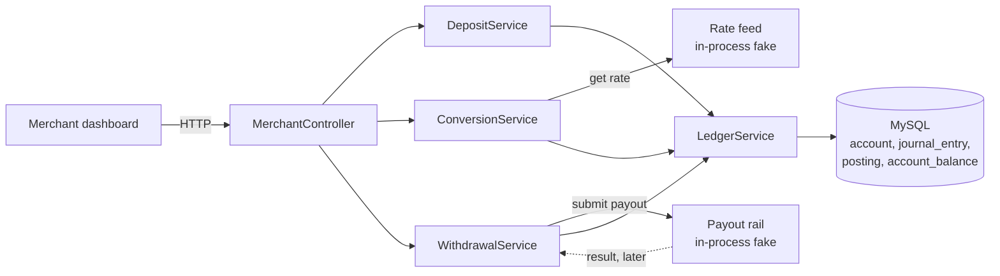
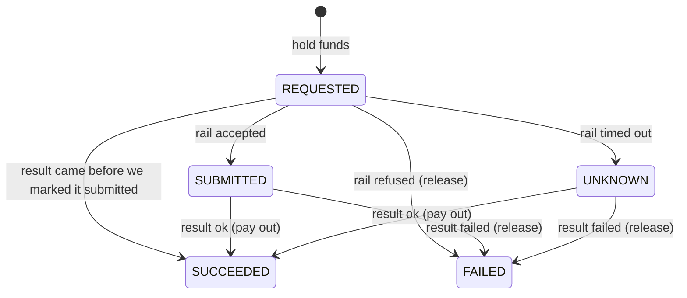

# Ezeebit wallet service

This is my take on the service that holds, converts and moves merchants' money. I built tasks 1, 2
and 3 from the brief: hold balances, convert between currencies, and withdraw. Tasks 4, 5 and 6 aren't
built, but I've described how they'd slot in.

## Overview

Everything sits on one double-entry ledger. A balance is never a number we edit. It's the sum of the
postings on an account, and every journal entry's postings add up to zero in each currency. So for any
balance, at any date, you can list exactly how it got there.



The three services never touch balances directly. They all go through `LedgerService.post()`, which
is the only way money moves.

Four rules keep the money right, even with flaky connections, retries and bursts of traffic:

1. **Every movement is one transaction.** A deposit, hold or conversion is one journal entry. Its
   postings and the balance updates commit together or not at all.
2. **We only debit if the money is there, in one SQL statement.**
   `UPDATE account_balance SET balance = balance + ? WHERE account_id = ? AND balance + ? >= 0`.
   If no row updates, there wasn't enough money and everything rolls back. There's no gap between
   reading a balance and writing it for a second request to sneak through.
3. **Every request has a natural key, and a repeat returns what already happened.** Deposits use the
   bank or chain reference, withdrawals use the `Idempotency-Key` header, conversions use the quote id.
   The key is unique in the database and is written in the same transaction as the money. The same key
   with a different request gets a 409.
4. **We never call an outside system inside a database transaction.** For a withdrawal, the money is
   held and committed first, then we call the payout rail. If we can't tell what the rail did, the
   withdrawal is `UNKNOWN` and the money stays held. It's never lost and never paid out twice.

The endpoints:

| Endpoint | What it does |
|---|---|
| `POST /merchants/{id}/deposits` | Money arrives. Stands in for the real bank or chain flow. `reference` dedupes. |
| `GET /merchants/{id}/balances` | Available and held, per currency. |
| `GET /merchants/{id}/accounts/{ccy}/entries` | The audit trail: every posting in that currency, newest first. |
| `POST /merchants/{id}/quotes` | A price for selling an amount of one currency for another, good for 30 seconds. |
| `POST /merchants/{id}/conversions` | Executes a quote. `quoteId` dedupes. |
| `POST /merchants/{id}/withdrawals` | Holds the money and sends it to the payout rail. `Idempotency-Key` header dedupes. |
| `GET /merchants/{id}/withdrawals/{wid}` | Where a withdrawal is now. |

The stack is Java 25, Spring Boot 4.1, MySQL 8.4 and Flyway, using plain SQL through `JdbcClient` (no
JPA). I wanted the locking and the SQL to be visible, because that's where the correctness lives.

## Run it

You need JDK 25 or newer, and Docker. Tests and local runs start MySQL 8.4 in a container for you.

```bash
./mvnw test                   # 28 tests, all against real MySQL
./mvnw spring-boot:test-run   # the app on http://localhost:8080, with a throwaway database
```

Then try it:

```bash
# Money arrives. Sending the same reference again returns the same deposit.
curl -s -X POST localhost:8080/merchants/m-1/deposits -H 'Content-Type: application/json' \
  -d '{"currency": "ZAR", "amount": 1000, "reference": "bank-tx-1"}'

curl -s localhost:8080/merchants/m-1/balances

# Quote selling 500 ZAR for USDT (good for 30 seconds), then execute it.
QUOTE=$(curl -s -X POST localhost:8080/merchants/m-1/quotes -H 'Content-Type: application/json' \
  -d '{"sellCurrency": "ZAR", "buyCurrency": "USDT", "sellAmount": 500}')
echo "$QUOTE"
curl -s -X POST localhost:8080/merchants/m-1/conversions -H 'Content-Type: application/json' \
  -d "{\"quoteId\": \"$(echo "$QUOTE" | sed 's/.*"id":"\([^"]*\)".*/\1/')\"}"

# Withdraw 100 ZAR to a bank account. Sending the same Idempotency-Key again returns the same withdrawal.
curl -s -X POST localhost:8080/merchants/m-1/withdrawals -H 'Content-Type: application/json' \
  -H 'Idempotency-Key: payout-1' \
  -d '{"currency": "ZAR", "amount": 100,
       "destination": {"type": "BANK", "accountNumber": "62000000001", "bankCode": "250655"}}'

curl -s localhost:8080/merchants/m-1/withdrawals/1

# Every posting on the merchant's ZAR accounts, newest first.
curl -s localhost:8080/merchants/m-1/accounts/ZAR/entries
```

The rate feed and payout rail are in-process fakes. Locally the fake rail accepts every withdrawal but
never reports back (there's no webhook endpoint), so withdrawals stay `SUBMITTED` with the money held.
The tests drive the results directly.

## The ledger

Four tables:

- **`account`**: one per owner, type and currency. An account only ever holds one currency, so two
  currencies can't get mixed in one balance. Merchant accounts are created on first use.
- **`journal_entry`**: one business event, like a deposit or a conversion. `(type, reference)` is
  unique, so the same event can't be booked twice.
- **`posting`**: a signed amount on one account. Positive raises the balance, negative lowers it.
- **`account_balance`**: a cache of the sum of postings, updated in the same transaction. It's there
  so checking a balance reads one row instead of adding up history. A test checks it always matches.

Account types:

| Type | Owner | Can go negative? | What it is |
|---|---|---|---|
| `AVAILABLE` | merchant | no | Money the merchant can spend. |
| `HELD` | merchant | no | Set aside for a withdrawal in flight. |
| `FX` | platform | no | The house's stock of each currency, used to fill conversions. Seeded by a migration. |
| `DEPOSITS_IN` | platform | yes | Mirror of money that came in from outside. |
| `PAYOUTS_OUT` | platform | yes | Mirror of money paid out. |
| `TREASURY` | platform | yes | Where the house FX stock was funded from. |

Whether an account can go negative comes from its type in code, so that rule lives in one place.
Currencies are a Java enum (ZAR, NGN and KES with 2 decimals, USDT and USDC with 6), since they only
change with a deploy anyway.

How each event is booked:

| Entry | Postings |
|---|---|
| `DEPOSIT` | merchant `AVAILABLE` +x, `DEPOSITS_IN` −x |
| `HOLD` | merchant `AVAILABLE` −x, merchant `HELD` +x |
| `PAYOUT` | merchant `HELD` −x, `PAYOUTS_OUT` +x |
| `RELEASE` | merchant `HELD` −x, merchant `AVAILABLE` +x |
| `CONVERSION` | merchant `AVAILABLE` (sell) −s, house `FX` (sell) +s, house `FX` (buy) −b, merchant `AVAILABLE` (buy) +b |
| `SEED` | house `FX` +stock, `TREASURY` −stock |

A conversion is one entry with four postings in two currencies. Each currency nets to zero on its own,
and both sides commit or neither does.

A few more details that matter for money:

- **Exact amounts.** `DECIMAL(38,18)` in MySQL and `BigDecimal` in Java. If you send more decimals
  than the currency has (1.005 ZAR), it's rejected, not rounded. The only rounding anywhere is a
  conversion's output, which rounds down in the house's favour.
- **No deadlocks.** Balance rows are always updated in account id order.
- **Exact text.** The database compares text byte for byte (`utf8mb4_0900_bin`). MySQL's default
  treats references `TX9a` and `TX9A` as the same, which would silently drop a deposit.
- **One clock.** The database session runs in UTC, so SQL and Java agree on time whatever the
  server's time zone.

## Withdrawals

```mermaid
sequenceDiagram
    participant M as Merchant
    participant W as Wallet
    participant DB as MySQL
    participant R as Payout rail
    M->>W: POST /withdrawals, Idempotency-Key: k
    W->>DB: BEGIN; insert withdrawal (REQUESTED); post HOLD; COMMIT
    Note over W,DB: not enough money: 422, nothing written, key can be reused
    W->>R: submit (our withdrawal id is the rail's idempotency key)
    alt accepted
        W->>DB: REQUESTED → SUBMITTED (only if still REQUESTED)
    else refused outright
        W->>DB: post RELEASE, FAILED
    else timeout or unclear
        W->>DB: REQUESTED → UNKNOWN, money stays held
    end
    W-->>M: 202 + current state
    R-->>W: later: onPayoutResult(id, succeeded)
    W->>DB: lock row; if not final: post PAYOUT or RELEASE, SUCCEEDED or FAILED
```



States only move forward. The first final result wins, and repeats change nothing. The edges straight
from `REQUESTED` to a final state are there because an async rail can answer before our "mark as
submitted" update runs. That update only applies if the withdrawal is still `REQUESTED`, so it can't
drag a finished withdrawal backwards.

The destination has to fit the currency. Fiat goes to `{type: BANK, accountNumber, bankCode}` and
stablecoins go to `{type: CHAIN, network, address}`. Anything else is a 400 `INVALID_DESTINATION`.

## Conversions

```mermaid
sequenceDiagram
    participant M as Merchant
    participant W as Wallet
    participant F as Rate feed
    participant DB as MySQL
    M->>W: POST /quotes {sell ZAR 1000, buy USDT}
    W->>F: rate(ZAR, USDT)
    Note over W: reject if it errors, is older than 10s, or is >2% off the last good rate (503)
    W->>DB: save quote: rate less 50 bps, buy amount rounded down, expires in 30s
    W-->>M: 201 {id, buyAmount 54.725, rate, expiresAt}
    M->>W: POST /conversions {quoteId}
    W->>DB: BEGIN; lock quote row
    alt already executed
        W-->>M: 201, same conversion
    else expired
        W-->>M: 422 QUOTE_EXPIRED
    else
        W->>DB: post CONVERSION (4 postings), link entry to quote, COMMIT
        Note over W,DB: merchant short: 422 INSUFFICIENT_FUNDS<br/>house short: 422 INSUFFICIENT_LIQUIDITY<br/>either way nothing moves and the quote is still usable
        W-->>M: 201
    end
```

The merchant gets the rate on their quote, not whatever the market is doing when they execute. The
house protects itself from a moving market in four ways:

- **A short window.** A quote is only good for 30 seconds.
- **A margin.** 50 bps comes off the feed rate (`wallet.fx.spread-bps`), which covers normal movement
  in that window.
- **No trustworthy rate, no quote.** We'd rather say no than quote on a bad price.
- **Finite stock.** House `FX` accounts can't go negative. If the house can't fill a conversion, it
  says so instead of going short.

## Error codes

Errors come back as `application/problem+json` with a `code` field.

| Code | HTTP | When |
|---|---|---|
| `INSUFFICIENT_FUNDS` | 422 | The merchant's available balance is too low. |
| `INSUFFICIENT_LIQUIDITY` | 422 | The house's FX stock can't fill the conversion. |
| `QUOTE_EXPIRED` | 422 | The quote is past its 30 seconds and was never executed. |
| `QUOTE_NOT_FOUND` | 404 | No such quote for this merchant. |
| `RATE_UNAVAILABLE` | 503 | The feed failed, or its rate was stale or out of line. |
| `IDEMPOTENCY_CONFLICT` | 409 | Same key or reference, different request. |
| `CURRENCY_MISMATCH` | 400 | A posting in the wrong currency, or converting a currency to itself. |
| `INVALID_AMOUNT` | 400 | Zero, too many decimals, or too large. |
| `INVALID_DESTINATION` | 400 | The destination doesn't fit the currency. |

## What goes wrong, and what handles it

| What goes wrong | What happens | What handles it |
|---|---|---|
| The dashboard sends the same deposit twice, or ten at once | One entry, every response is the same deposit | Unique `(type, reference)` on `journal_entry` |
| The same withdrawal is sent twice, or at the same time | One hold, one rail submit, same response | Unique `(merchant_id, idempotency_key)` |
| Same key, different amount or destination | 409, nothing moves | The request is compared on replay |
| 50 withdrawals at once against a balance that covers 10 | Exactly 10 go through, 40 get 422 | The conditional debit |
| A withdrawal bigger than the balance | 422, no withdrawal saved, key can be retried | The hold rolls back with the row |
| The rail times out | `UNKNOWN`, money stays held | Rule 4 in the overview |
| The rail refuses outright | `FAILED`, money back in available straight away | `PayoutRail.Rejected` |
| The rail sends its result twice | The second one changes nothing | Row lock and final-state check, plus unique `(PAYOUT, id)` as a backstop |
| The rail says "failed" after it said "succeeded" | Nothing changes, logged for a human | Final states are final |
| The result arrives before we mark the withdrawal submitted | Settles normally | Results are accepted from `REQUESTED` |
| The app dies after the hold but before calling the rail | Stuck in `REQUESTED`, money held but not lost | Not handled yet, needs a sweeper (see below) |
| The rate feed errors or is slow | 503, no quote | We fail closed |
| The feed rate is older than 10 seconds | 503, no quote | Age check |
| The feed rate jumps more than 2% | 503, and the outlier isn't trusted as the new normal | Last-good-rate check |
| The market moves between quote and execution | The merchant gets the quoted rate within 30s, then 422 | Expiry and margin |
| A merchant converts more than they hold | 422 `INSUFFICIENT_FUNDS`, quote still usable | The conditional debit |
| The house runs out of a currency | 422 `INSUFFICIENT_LIQUIDITY`, nothing moves | `FX` accounts can't go negative |
| The same quote is executed twice, or ten at once | One conversion, everyone gets it back | Quote row lock |

## How tasks 4, 5 and 6 would fit

**Task 4: accept an incoming crypto payment.** The deposit flow already does the hard part, booking
an event once based on its outside id. What's missing is "we've seen it, but it's not final yet".

1. Add a `chain_payment` row, unique on `(network, tx_hash, log_index)`. Each notification updates its
   confirmation count, and duplicates hit the same row and change nothing.
2. Add a merchant `PENDING` account. When we first see a payment, book `DEPOSITS_IN → PENDING`. The
   merchant sees money coming in but can't spend it yet.
3. Once confirmations reach a per-network threshold (say 20 on Tron, 12 on Ethereum), book
   `PENDING → AVAILABLE` with the same reference. If the transaction drops off the chain before that,
   book it back to `DEPOSITS_IN`.
4. The deposit address tells us the merchant, so we never trust a merchant id in the notification.

**Task 5: auto-settle incoming crypto to local currency.** This is a conversion the system starts
instead of the merchant.

1. Add `settlement_rule (merchant_id, from_currency, to_currency, percent)`.
2. When a stablecoin payment becomes available (task 4), the same transaction moves the rule's share
   into `HELD` and saves an `auto_conversion` row keyed on the payment's reference. Holding it means the
   merchant can't spend money that's about to be converted.
3. A worker picks those rows up, gets a quote and executes it through `ConversionService`. If there's
   no rate or the house is short, it retries with backoff. After a set time it releases the hold and
   tells the merchant the conversion didn't happen.
4. The merchant sees "100 USDT received, 80 USDT converting to ZAR", then the conversion and its rate.

**Task 6: route payouts across countries and partners.** `PayoutRail` is already the seam, since the
withdrawal flow doesn't care who pays out.

1. A `PayoutRouter` implements `PayoutRail`. It picks a partner by country and currency from config:
   each partner's limits, priority, and health (a circuit breaker on errors and slowness).
2. Each try is a `payout_attempt` row `(withdrawal_id, partner, attempt_no, state)`, and the rail's
   idempotency key becomes the withdrawal id plus the attempt number.
3. We only try the next partner when the current one definitely refused, or a status check confirms it
   never sent the money. After a timeout we don't know, so we don't fail over, because that's exactly
   how a merchant gets paid twice. The withdrawal stays `UNKNOWN` until we know.
4. The money stays in `HELD` across attempts, so the ledger doesn't change. `PAYOUTS_OUT` becomes one
   account per partner, which makes it easy to reconcile against each partner's statement.

## Assumptions

- **No fees.** The house only earns the conversion margin.
- **Merchants are trusted ids from the URL.** There's no merchant table, auth or KYC, as the brief
  allows. Any valid id gets accounts on first use.
- **Deposits are an endpoint** standing in for money arriving from a bank or chain.
- **A stablecoin is one currency whatever the chain.** USDT on Tron and on Ethereum share a balance,
  and the chain is a detail of the payout destination.
- **Currencies:** ZAR, NGN, KES, USDT and USDC.
- **The merchant says how much they sell.** "Buy exactly 100 USDT" quotes aren't supported.
- **Any pair converts.** The brief talks about fiat to stablecoin, but the code also allows ZAR to NGN
  and USDT to USDC. A product rule could narrow that.
- **Numbers I picked:** quotes last 30 seconds, feed rates can be at most 10 seconds old and at most 2%
  off the last good rate, the margin is 50 bps, and the house stock is seeded by a migration.
- **One margin for everything.** Real pricing would vary by pair (NGN costs more to hedge) and by
  merchant.
- **Executing a quote again returns the same conversion** instead of an error, so a client that lost
  the response can find out what happened.
- **The rail reports results by calling `WithdrawalService.onPayoutResult()`.** In production a signed
  webhook would call it.
- **"Settle in local currency the next day"** isn't modelled. Task 5 is the closest piece.

## What I'd do with more time

Most important first:

1. **Recover stuck withdrawals.** A withdrawal stuck in `REQUESTED` (crash before the rail call) or
   `UNKNOWN` (timeout) keeps its money held until a person looks. A sweeper should resubmit the
   `REQUESTED` ones, which is safe because the rail dedupes on our id, and ask the rail about the
   `UNKNOWN` ones.
2. **Authentication.** Today anyone who can reach the API can act as any merchant by putting their id
   in the URL. The code only checks the id's format, keeps `platform` out of reach, and scopes lookups
   so merchant A's withdrawal is a 404 for merchant B. I'd add:
   - **An API key or OAuth token per merchant,** checked at the gateway or with Spring Security.
   - **The merchant id from the token, not the URL.** Either drop `{id}` from the path or reject a
     request where they don't match. This one matters most, because the ledger trusts whatever
     merchant id it's given.
   - **Extra checks for withdrawals,** the riskiest action: a second factor or an allowlist of payout
     destinations.

   None of this touches the ledger or the services. It sits in front of the controller.
3. **A webhook endpoint for rail results,** with signature checks and replay protection. Without a
   signature, anyone could fake a "payout failed" and get the money released. Chain notifications in
   task 4 need the same.
4. **Reconciliation.** A daily job that rebuilds every balance from its postings and checks
   `PAYOUTS_OUT` and `DEPOSITS_IN` against bank and chain statements.
5. **Managing the house FX stock.** Alerts when it runs low, plus rebalancing and hedging. Right now it
   only moves when merchants convert.
6. **Hot rows.** Every conversion in a currency locks that currency's one house `FX` row. On payday
   that row becomes a queue. We could split it into several sub-accounts, or book the house side
   from a queue.
7. **Pricing.** A margin per pair and per merchant, a separate revenue account for it, and the last
   good rate in a shared store. It's in memory now, so it resets on restart.
8. **Smaller things.** Paging for entries (it's the newest 100 for now), "buy exactly X" quotes,
   alerts on `UNKNOWN` withdrawals and `RATE_UNAVAILABLE`, and a merchant table with limits.

## Tests

All 28 tests run against real MySQL 8.4 in Docker. I didn't use an in-memory database because the
guarantees depend on MySQL's own locking, unique indexes and text comparison.

| Test class | What it proves |
|---|---|
| `LedgerServiceTests` | Every cached balance matches its postings, and every currency nets to zero across the whole ledger. Mixed-currency entries, wrong-currency postings and over-precise amounts are rejected. An overdraft moves nothing. Creating the same account concurrently is safe. |
| `DepositApiTests` | A repeated deposit is booked once, including 10 at the same time. Same reference with a different amount is a 409. References that differ only in case are separate deposits. Bad input moves nothing. |
| `WithdrawalApiTests` | 50 racing withdrawals never overspend. A successful payout settles once, however often the result arrives. A failed payout releases the hold once. A rail refusal releases straight away. A timeout keeps the money held until the result arrives. A repeat only reaches the rail once. A short balance is rejected and the key can be retried. Bad destinations and amounts move nothing. |
| `ConversionApiTests` | A conversion moves both sides and the house stock once, and repeats return it, even after expiry. 10 racing executions of one quote book once. Expired quotes are rejected. Stale, outlying and failed rates give no quote. Converting too much is rejected and the quote stays usable. A house shortfall moves nothing. |

## How I used AI

I used Claude Code to plan the design with me, then to write the code and docs one step at a time. It
ran the full test suite after each step and told me where the code had drifted from the plan before I
committed. These are the places where I changed or overrode what it suggested, and the bigger
suggestions I accepted.

What I changed or rejected:

- **No recovery sweeper in code.** It proposed a scheduled job to resubmit stuck withdrawals. Without
  one, money can get stuck in `HELD` but is never lost or paid twice, so I kept it as a write-up.
- **No webhook endpoint.** It proposed an HTTP endpoint for rail results. The tests call the service
  directly, so the endpoint wouldn't prove anything extra.
- **The house FX position can't go negative.** It let the platform FX account go negative as "the
  position to hedge". I wanted it to stay at zero or above, so conversions can fail on liquidity and the
  house stock is seeded.
- **No `currency` table and no `allow_negative` column.** It planned both. I had currencies as a Java
  enum, and "can go negative" worked out from the account type, so each rule lives in one place.
- **No generic idempotency table.** It planned and built one that stored every response. I questioned
  whether we needed it. We kept the standard `Idempotency-Key` header for withdrawals but store it on
  the withdrawal row, and deposits and conversions dedupe on their natural keys.
- **Java version.** I asked for the newest release (27). It pushed back to 25 LTS because of tooling
  lag and reviewers' setups, and I agreed.

What I accepted:

- **The core design:** a double-entry ledger, the idempotency key written in the same transaction as
  the work, the conditional debit, and real MySQL in tests instead of H2.
- **Early payout results.** It noticed an async rail can answer before we mark a withdrawal as
  submitted, and allowed for that. This wasn't in the plan.
- **Repeating a quote returns the conversion.** The plan said both "conversions dedupe on the quote
  id" and "a reused quote is an error". It spotted the contradiction and went with returning the
  conversion, which matches deposits and withdrawals.
- **A time zone fix.** While testing quote expiry it found that every timestamp from MySQL was 2 hours
  off when the JVM isn't on UTC, including the existing entries endpoint. It pinned the database
  session to UTC and showed the test failing without the fix.
- **One FX margin.** I asked whether we add a margin on the rate. It's a single 50 bps plus rounding
  down. I kept it simple and wrote up the limits instead of building more.
