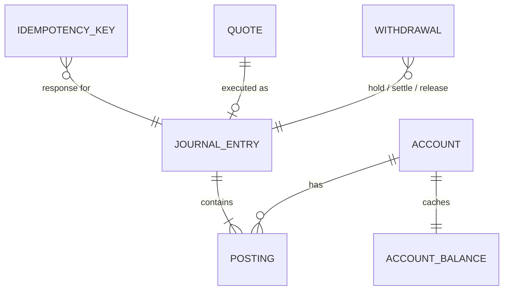
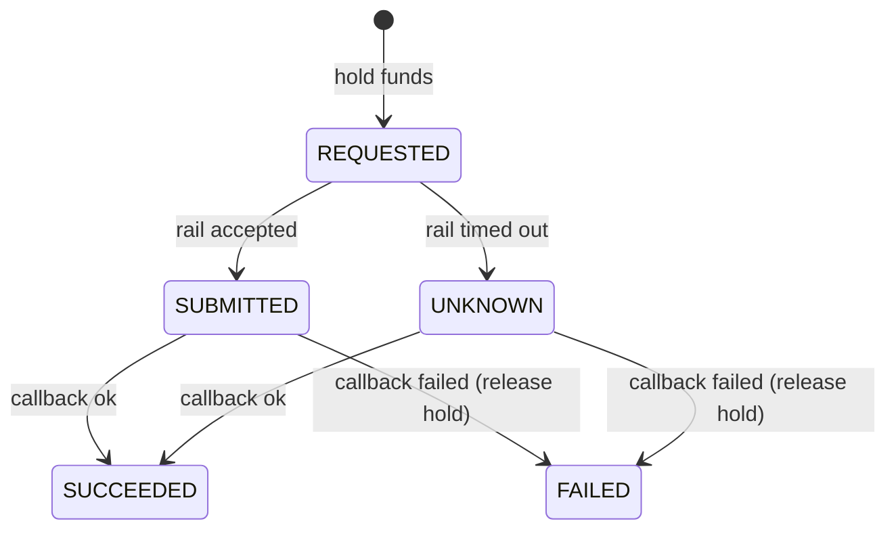

# Solution

## 1. TL;DR

<!-- TODO: three sentences. Tasks 1, 2 and 3, built thin on one double-entry ledger. -->

## 2. Core model: the ledger

<!-- TODO: account, journal_entry, posting, account_balance (cache).
     Account types: merchant available/held, platform fx (seeded, non-negative),
     external deposits_in/payouts_out/treasury (allow_negative).
     Posting tables for deposit, hold, payout, release, conversion. -->

## 3. Safety rules

<!-- TODO: idempotency key in the same transaction, conditional debit,
     lock ordering by account id, forward-only state machines. -->

## 4. Flows

### Deposit
<!-- TODO: sequence diagram -->

### Withdrawal
<!-- TODO: sequence diagram -->

### Conversion
<!-- TODO: sequence diagram: quote -> execute -->

## 5. What goes wrong, and what handles it

| Failure | What happens | Handled by |
|---|---|---|
| <!-- TODO --> | | |

## 6. How tasks 4, 5 and 6 fit

<!-- TODO -->

## 7. Assumptions and ambiguities

- No fees.
- A stablecoin is one currency regardless of chain; the chain is a payout destination detail.
- Currencies: ZAR, NGN, KES, USDT, USDC.
<!-- TODO: quote TTL, rate staleness, "settle next day" -->

## 8. Gaps, and what I'd do with more time

<!-- TODO: outbox + sweeper for stuck REQUESTED/UNKNOWN withdrawals,
     signed webhook endpoint, reconciliation, hedging, hot accounts. -->

## 9. How to verify

<!-- TODO: test list and what each proves -->
