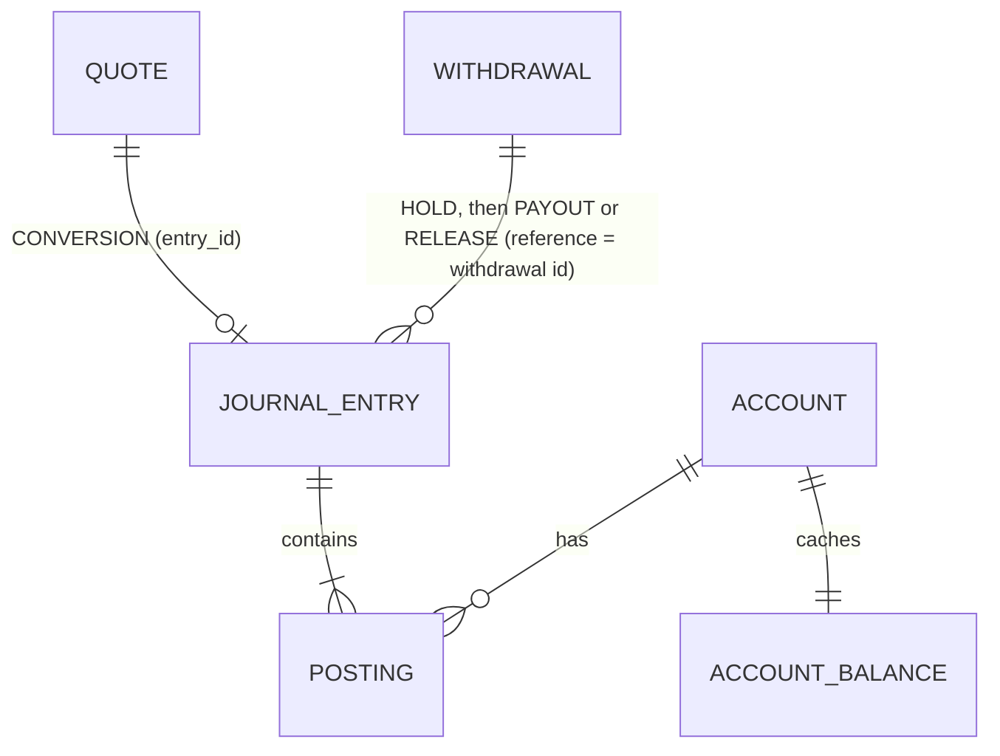
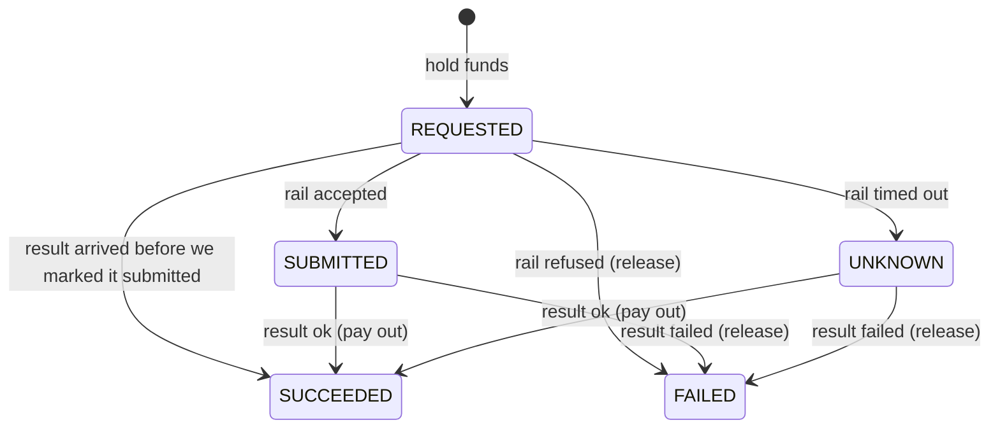

# Solution

## 1. TL;DR

I built tasks 1, 2 and 3 (hold balances, convert, withdraw) on one double-entry ledger, in Java 25,
Spring Boot 4.1 and MySQL 8.4. Every movement of money is one balanced journal entry, written in one
database transaction, with debits guarded by a conditional update and every request deduplicated on a
natural key. Tasks 4, 5 and 6 slot into the same design as new entry types, a background worker and a
router behind the existing `PayoutRail` interface (section 6).

What is built:

| Endpoint | What it does |
|---|---|
| `POST /merchants/{id}/deposits` | Money arrives. `reference` (bank or chain tx id) dedupes. Stands in for the real inbound flow. |
| `GET /merchants/{id}/balances` | Available and held, per currency. |
| `GET /merchants/{id}/accounts/{ccy}/entries` | Audit trail: every posting on that currency, newest first. |
| `POST /merchants/{id}/quotes` | Price for selling an amount of one currency for another, firm for 30 seconds. |
| `POST /merchants/{id}/conversions` | Executes a quote. `quoteId` dedupes. |
| `POST /merchants/{id}/withdrawals` | Holds the money and sends it to the payout rail. `Idempotency-Key` header dedupes. |
| `GET /merchants/{id}/withdrawals/{wid}` | Current state of a withdrawal. |

## 2. Core model: the ledger

A balance is never a number we edit. It is the sum of postings, and every posting belongs to a journal
entry whose postings sum to zero in each currency. That answers "how did this balance get here?" for
any date: list the postings.



- **`account`**: one per (owner, type, currency). An account holds exactly one currency, so two
  currencies can never be mixed in one balance. Merchant accounts are created on first use.
- **`journal_entry`**: one business event (a deposit, a hold, a conversion). `(type, reference)` is
  unique, so the same event can never be booked twice.
- **`posting`**: signed amount on one account. Positive raises the balance, negative lowers it.
- **`account_balance`**: a cache of `SUM(posting.amount)`, updated in the same transaction as the
  postings. It exists so a balance check is one row, not a scan. A test checks it always equals the sum.

Account types:

| Type | Owner | May go negative | Meaning |
|---|---|---|---|
| `AVAILABLE` | merchant | no | Money the merchant can spend. |
| `HELD` | merchant | no | Reserved for a withdrawal in flight. |
| `FX` | platform | no | The house's stock of each currency, used to fill conversions. Seeded by migration. |
| `DEPOSITS_IN` | platform | yes | Mirror of money that came in from outside. |
| `PAYOUTS_OUT` | platform | yes | Mirror of money paid out. |
| `TREASURY` | platform | yes | Where the house FX stock was funded from. |

"May go negative" comes from the account type in code, so the rule lives in one place.
Currencies are a Java enum (ZAR, NGN, KES: 2 decimals; USDT, USDC: 6 decimals) because they only change
with a deploy.

How each event is booked:

| Entry | Postings |
|---|---|
| `DEPOSIT` | merchant `AVAILABLE` +x, `DEPOSITS_IN` −x |
| `HOLD` | merchant `AVAILABLE` −x, merchant `HELD` +x |
| `PAYOUT` | merchant `HELD` −x, `PAYOUTS_OUT` +x |
| `RELEASE` | merchant `HELD` −x, merchant `AVAILABLE` +x |
| `CONVERSION` | merchant `AVAILABLE`(sell) −s, house `FX`(sell) +s, house `FX`(buy) −b, merchant `AVAILABLE`(buy) +b |
| `SEED` | house `FX` +stock, `TREASURY` −stock |

A conversion is one entry with four postings across two currencies. Each currency nets to zero on its
own, and both legs commit or neither does.

## 3. Safety rules

These are the rules every flow follows. Each one is backed by a test (section 9).

1. **One event, one transaction.** Postings and balance updates for an entry are written together or
   not at all. `LedgerService.post()` is the only way money moves.
2. **Debit only if the money is there, in one statement.**
   `UPDATE account_balance SET balance = balance + ? WHERE account_id = ? AND balance + ? >= 0`.
   Zero rows updated means not enough money, and the whole transaction rolls back. There is no
   "read the balance, then write" gap for a concurrent request to slip through.
3. **Lock in a fixed order.** Balance rows are updated in account id order, so two entries touching the
   same accounts cannot deadlock.
4. **Dedupe on a natural key, inside the same transaction as the work.** Deposits use the external
   reference, withdrawals use the `Idempotency-Key` header (unique per merchant), conversions use the
   quote id. A replay returns the current state of what was already done. The same key with a different
   body is a 409 `IDEMPOTENCY_CONFLICT`. There is no separate idempotency table: the key lives on the
   row it protects, so they cannot disagree.
5. **Never call the outside world inside a database transaction.** The withdrawal hold commits first;
   the payout rail is called after. If we cannot tell what the rail did, we say so (`UNKNOWN`) and keep
   the money held. It is never lost and never paid twice.
6. **States only move forward.** State changes are conditional (`... WHERE state = 'REQUESTED'`) or made
   under a row lock. The first final result wins; repeats change nothing.
7. **Exact amounts.** `DECIMAL(38,18)` in MySQL and `BigDecimal` in Java. Input finer than the currency
   allows (1.005 ZAR) is rejected, never rounded. The only rounding is a conversion's output, which
   rounds down, in the house's favour.
8. **Exact text.** The database collation is `utf8mb4_0900_bin`, so references `TX9a` and `TX9A` are
   different deposits. MySQL's default would treat them as the same and silently drop one.

## 4. Flows

### Deposit

```mermaid
sequenceDiagram
    participant M as Merchant / inbound system
    participant W as Wallet
    participant DB as MySQL
    M->>W: POST /deposits {ZAR, 100, ref}
    W->>DB: BEGIN; post DEPOSIT (merchant/ref); COMMIT
    alt (DEPOSIT, merchant/ref) already exists
        DB-->>W: duplicate key, rolled back
        W->>DB: read the existing deposit (outside the failed transaction)
        W-->>M: 201, same deposit (or 409 if amount/currency differ)
    else new
        W-->>M: 201
    end
```

### Withdrawal

```mermaid
sequenceDiagram
    participant M as Merchant
    participant W as Wallet
    participant DB as MySQL
    participant R as Payout rail
    M->>W: POST /withdrawals, Idempotency-Key: k
    W->>DB: BEGIN; insert withdrawal (REQUESTED); post HOLD; COMMIT
    Note over W,DB: short balance: 422, nothing written, key reusable
    W->>R: submit(withdrawal id = rail's idempotency key)
    alt accepted
        W->>DB: REQUESTED → SUBMITTED (only if still REQUESTED)
    else refused outright
        W->>DB: post RELEASE; FAILED
    else timeout / unclear
        W->>DB: REQUESTED → UNKNOWN; money stays held
    end
    W-->>M: 202 + current state
    R-->>W: later: onPayoutResult(id, succeeded)
    W->>DB: lock row; if not final: post PAYOUT or RELEASE; SUCCEEDED or FAILED
```



The `REQUESTED → SUCCEEDED/FAILED` edges exist because an asynchronous rail can answer before our
"mark as submitted" update runs. That update is conditional, so it never drags a finished withdrawal
backwards.

Destinations are checked against the currency: fiat goes to `{type: BANK, accountNumber, bankCode}`,
stablecoins to `{type: CHAIN, network, address}`. Anything else is a 400 `INVALID_DESTINATION`.

### Conversion

```mermaid
sequenceDiagram
    participant M as Merchant
    participant W as Wallet
    participant F as Rate feed
    participant DB as MySQL
    M->>W: POST /quotes {sell ZAR 1000, buy USDT}
    W->>F: rate(ZAR, USDT)
    Note over W: reject if error, older than 10s, or >2% from last good rate (503)
    W->>DB: insert quote: rate − 50 bps, buy amount rounded down, expires in 30s
    W-->>M: 201 {id, buyAmount 54.725, rate, expiresAt}
    M->>W: POST /conversions {quoteId}
    W->>DB: BEGIN; lock quote row
    alt already executed
        W-->>M: 201, same conversion
    else expired
        W-->>M: 422 QUOTE_EXPIRED
    else
        W->>DB: post CONVERSION (4 postings); quote.entry_id = entry; COMMIT
        Note over W,DB: merchant short: 422 INSUFFICIENT_FUNDS<br/>house short: 422 INSUFFICIENT_LIQUIDITY<br/>either way nothing moves, quote still usable
        W-->>M: 201
    end
```

Which rate the merchant gets: the rate on their quote, not the market rate at execution. The house
protects itself from the moving market in four ways:

- **Short window.** A quote is firm for 30 seconds only.
- **Spread.** 50 bps comes off the feed rate (`wallet.fx.spread-bps`), which covers normal movement
  within the window.
- **Fail closed.** No trustworthy rate means no quote, rather than a quote on a bad price.
- **Finite stock.** House `FX` accounts cannot go negative. If the house cannot fill a conversion, it
  says so instead of going short.

### Error codes

| Code | HTTP | When |
|---|---|---|
| `INSUFFICIENT_FUNDS` | 422 | Merchant's available balance is too low. |
| `INSUFFICIENT_LIQUIDITY` | 422 | House FX stock cannot fill the conversion. |
| `QUOTE_EXPIRED` | 422 | Quote is past its 30 seconds and was never executed. |
| `QUOTE_NOT_FOUND` | 404 | No such quote for this merchant. |
| `RATE_UNAVAILABLE` | 503 | Feed failed, or its rate was stale or out of line. |
| `IDEMPOTENCY_CONFLICT` | 409 | Same key or reference, different request. |
| `CURRENCY_MISMATCH` | 400 | Posting in the wrong currency, or converting a currency to itself. |
| `INVALID_AMOUNT` | 400 | Zero, too many decimals, or too large. |
| `INVALID_DESTINATION` | 400 | Destination does not fit the currency. |

Errors are `application/problem+json` with a `code` field.

## 5. What goes wrong, and what handles it

| Failure | What happens | Handled by |
|---|---|---|
| Dashboard sends the same deposit twice, or ten at once | One entry; every response is the same deposit | Unique `(type, reference)` on `journal_entry` |
| Same withdrawal sent twice, or concurrently | One hold, one rail submit, same response | Unique `(merchant_id, idempotency_key)` |
| Same key, different amount or destination | 409, nothing moves | Body compared on replay |
| 50 withdrawals at once against a balance that covers 10 | Exactly 10 succeed, 40 get 422 | Conditional debit |
| Withdrawal larger than the balance | 422; no withdrawal row; key can be retried | Hold rolls back with the row |
| Rail times out | `UNKNOWN`, money stays held | Section 3, rule 5 |
| Rail refuses outright | `FAILED`, money back in available at once | `PayoutRail.Rejected` |
| Rail result arrives twice | Second one changes nothing | Row lock + final-state check; `(PAYOUT, id)` unique as a backstop |
| Rail says "failed" after it said "succeeded" | Nothing changes; logged for a human | Final state is final |
| Rail result arrives before we mark the withdrawal submitted | Settles normally | Results accepted from `REQUESTED`; later update is conditional |
| Process dies after the hold, before the rail call | Stuck in `REQUESTED`, money held, not lost | Gap: needs a sweeper (section 8) |
| Rate feed errors or is slow | 503, no quote | Fail closed |
| Feed rate older than 10 seconds | 503, no quote | Age check |
| Feed rate jumps more than 2% | 503, and the outlier is not trusted as the new reference | Last-good-rate check |
| Market moves between quote and execution | Merchant gets the quoted rate within 30s; after that, 422 | Expiry + spread |
| Merchant converts more than they hold | 422 `INSUFFICIENT_FUNDS`; quote still usable | Conditional debit |
| House runs out of a currency | 422 `INSUFFICIENT_LIQUIDITY`; nothing moves | `FX` accounts cannot go negative |
| Same quote executed twice, or ten at once | One conversion; all callers get it | Quote row lock + `entry_id` |
| JVM and database in different time zones | Timestamps agree | JDBC session pinned to UTC |

## 6. How tasks 4, 5 and 6 fit

**Task 4: accept an incoming crypto payment.** The deposit flow already does the important part:
booking an event once, keyed on its external id. What is missing is "seen, but not final yet".

- Add a `chain_payment` row keyed on `(network, tx_hash, log_index)`, unique. Each notification from
  the confirmation service updates its confirmation count. Duplicates hit the same row and change nothing.
- Add a merchant `PENDING` account. On first sight, book `DEPOSITS_IN → PENDING`, so the merchant sees
  money incoming but cannot spend it.
- When confirmations reach a per-network threshold (config, e.g. 20 on Tron, 12 on Ethereum), book
  `PENDING → AVAILABLE` with the same reference. If the transaction drops off the chain first, book
  the reverse into `DEPOSITS_IN`.
- The deposit address maps to the merchant, so the merchant id never comes from the notification body.

**Task 5: auto-settle incoming crypto to local currency.** This is a conversion the system starts
instead of the merchant.

- `settlement_rule (merchant_id, from_currency, to_currency, percent)`.
- When a stablecoin payment becomes `AVAILABLE` (task 4), the same transaction moves the rule's share
  into `HELD` and writes an `auto_conversion` row keyed on the payment's reference. Holding it means
  the merchant cannot spend money that is about to be converted, so the outcome is predictable.
- A worker picks up pending rows, gets a quote, and executes it through `ConversionService`. If the
  rate is unavailable or the house is short, it retries with backoff. After a set time it releases the
  hold and tells the merchant the conversion did not happen.
- The merchant sees: "100 USDT received, 80 USDT converting to ZAR", then the conversion entry and
  its rate. The share rounds down to the currency's decimals.

**Task 6: route payouts across countries and partners.** `PayoutRail` is already the seam: the
withdrawal flow does not care who pays out.

- A `PayoutRouter` implements `PayoutRail`. It picks a partner by country and currency from config:
  per-partner limits (minimum, maximum, daily cap), priority, and health (a circuit breaker on errors
  and latency).
- Each try becomes a `payout_attempt` row `(withdrawal_id, partner, attempt_no, state)`. The rail
  idempotency key becomes withdrawal id + attempt number.
- Fail over to the next partner **only** when the current one definitely refused, or a status query
  confirms it never sent the money. On a timeout we do not know, so we do not fail over: that is how
  merchants get paid twice. The withdrawal stays `UNKNOWN` until the partner's status is known.
- The money stays in `HELD` across attempts, so the ledger does not change. `PAYOUTS_OUT` becomes one
  account per partner, which makes reconciling against each partner's statement simple.

## 7. Assumptions and ambiguities

- **No fees.** The house earns only the conversion spread.
- **Merchants are trusted ids.** The merchant comes from the path. There is no merchant table, auth or
  KYC, as the brief allows. Any valid id gets accounts on first use.
- **Deposits are an endpoint.** `POST /deposits` stands in for money arriving from a bank or chain.
- **A stablecoin is one currency regardless of chain.** USDT on Tron and USDT on Ethereum share a
  balance; the chain is a payout destination detail.
- **Currencies:** ZAR, NGN, KES, USDT, USDC.
- **The merchant names the amount they sell.** "Buy exactly 100 USDT" quotes are not supported.
- **Any pair converts.** The brief talks about fiat ↔ stablecoin; the code also allows ZAR ↔ NGN and
  USDT ↔ USDC. A product rule could narrow this.
- **Numbers I picked:** quote valid 30 seconds, feed rate at most 10 seconds old, at most 2% from the
  last good rate, 50 bps spread, house stock seeded by migration.
- **One spread for everything.** Every pair and merchant gets 50 bps. Real pricing would vary by pair
  (NGN costs more to hedge) and by merchant.
- **Replaying an executed quote returns the conversion** rather than an error, so a client that lost
  the response can find out what happened.
- **The rail reports results by calling `WithdrawalService.onPayoutResult()`.** In production a signed
  webhook would call it.
- **"Settle in local currency the next day"** is the business's settlement promise. It is not modelled
  here; task 5 is the closest piece.

## 8. Gaps, and what I'd do with more time

Most important first.

1. **Recover stuck withdrawals.** A withdrawal left in `REQUESTED` (crash before the rail call) or
   `UNKNOWN` (timeout) keeps its money held until a person looks. A sweeper should resubmit `REQUESTED`
   ones (safe, since the rail dedupes on our id) and ask the rail for the status of `UNKNOWN` ones.
2. **Webhook endpoint for rail results,** with signature checks and replay protection, calling
   `onPayoutResult()`.
3. **Reconciliation.** A daily job that recomputes every balance from postings and checks `PAYOUTS_OUT`
   and `DEPOSITS_IN` against bank and chain statements.
4. **House FX management.** Alerts when stock runs low, rebalancing and hedging. Today the stock only
   moves with merchant conversions.
5. **Hot rows.** Each house `FX` balance is one row that every conversion in that currency locks. At
   payday volume that row serialises conversions. Fixes: split it into several sub-accounts, or book
   house legs asynchronously from a queue.
6. **Pricing.** Spreads per pair and per merchant, a separate revenue account for the spread, and the
   last-good rate in a shared store (it is in memory now, so it resets on restart and is per instance).
7. **Smaller items.** Pagination for entries (newest 100 only today), "buy exactly X" quotes, metrics
   and alerts on `UNKNOWN` withdrawals and `RATE_UNAVAILABLE`, a merchant table with limits.

## 9. How to verify

```bash
./mvnw test
```

28 tests, all against a real MySQL 8.4 in Docker (Testcontainers). Real MySQL rather than an in-memory
database because the guarantees depend on MySQL's locking, unique indexes and collation.

| Test class | What it proves |
|---|---|
| `LedgerServiceTests` | Every cached balance equals the sum of its postings and every currency nets to zero across the whole ledger. Mixed-currency and wrong-currency entries are rejected. Over-precise amounts are rejected. An overdraft moves nothing. Concurrent account creation is safe. |
| `DepositApiTests` | A replayed deposit is booked once. 10 concurrent replays book once. Same reference with a different amount is a 409. References differing only in case are separate deposits. Bad input moves nothing. |
| `WithdrawalApiTests` | 50 racing withdrawals never overspend. A successful payout settles once however often the result arrives. A failed payout releases the hold once. A rail refusal releases straight away. A timeout keeps money held until the result arrives. A replay submits to the rail once. A short balance is rejected and the key can be retried. Bad destinations and amounts move nothing. |
| `ConversionApiTests` | A conversion moves both legs and the house stock once, and replays (even after expiry). 10 racing executions of one quote book once. Expired quotes are rejected. Stale, outlying and failed rates give no quote. Over-conversion is rejected and the quote stays usable. A house shortfall moves nothing. |
